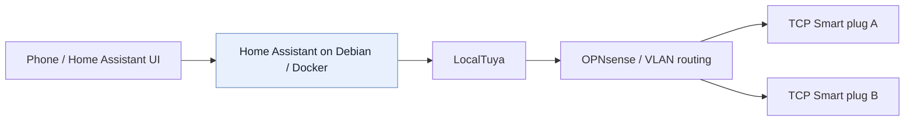

# Recovering local control of two TCP Smart Wi-Fi plugs

**A real-world troubleshooting case study:** network analysis, Android diagnostics, Python, and Home Assistant — without resetting or re-pairing the original devices.

**Outcome:** **2/2 plugs working through Home Assistant** using local Tuya protocol 3.1 commands. The original TCP Smart app pairing was retained. Completed **24 October 2026**.

> This is a case study of my own devices and environment, **not a turnkey key-recovery toolkit**. The accompanying Python example is a **sanitised, reconstructed demonstration** of the final LAN-control validation — not an unedited copy of the original forensic scripts. No keys, device IDs, MAC addresses, app databases or raw memory dumps are published.

## The problem

I had two older TCP Smart Wi-Fi plugs that still worked in their original Android app. I wanted them in my Home Assistant setup, controlled **directly on my LAN**, while retaining the existing pairing. A factory reset or moving them to another app would have been easier, but it would not have answered the technical question.

The first obstacle wasn't connectivity: both plugs were reachable locally. For encrypted on/off commands, however, each plug required its own 16-character local key, which the OEM app did not expose.

## Outcome at a glance

| Requirement | Verified result |
| --- | --- |
| Read relay states without changing the devices | Yes — TinyTuya protocol 3.1 reported DPS 1 on both plugs |
| Recover candidate local keys without re-pairing | Yes — using an inspectable emulator and targeted runtime diagnostics |
| Prove encrypted local on/off control | Yes — independently tested on both devices |
| Preserve original TCP Smart pairing | Yes |
| Show the original app reflecting an external relay change | Yes — observed for the standing lamp |
| Integrate with Home Assistant | Yes — both working as LocalTuya switch entities |
| Configure Tuya Cloud API credentials in Home Assistant | **Not required** |
| Prove operation with all internet/cloud access blocked | **Not yet tested** |
| Quantify response-time improvement | **Not yet measured** |

## Setup (sanitised)

- Two **TCP Smart** UK Wi-Fi plug models in the **TAFWISSINWUK** family, firmware compatible with **Tuya LAN protocol 3.1**.
- **OPNsense** routing between a trusted/home-lab VLAN and an isolated IoT VLAN; both plugs reachable over **TCP/6668**.
- **Lenovo Yoga / Debian 13** running **Home Assistant Container** under Docker Compose.
- Windows workstation for Android Studio, ADB, inspection tooling and the initial Python checks.
- Android Studio test emulator running the genuine OEM app, signed into the existing account; **the everyday handset was not rooted**.



The arrows show the *command path tested in Home Assistant*. The original OEM app remained paired separately; its cloud/LAN status-update mechanism wasn't conclusively traced.

## How I approached it

1. **Establish the basics.** Confirm model identifiers, network addresses, reachability and local protocol behaviour using packet captures, a TCP connection test and TinyTuya status requests.
2. **Separate read from write.** Protocol 3.1 returned the two plugs' relay status with an empty local key. That did **not** permit encrypted on/off control.
3. **Investigate the OEM Android app.** Used ADB to retrieve its installed APK components; confirmed Tuya/ThingClips SDK references to local-key handling. APK inspection alone did not reveal the account's individual device keys.
4. **Test, then discard unsuccessful approaches.** Investigated app storage and MMKV; tested **Frida** attachment in a rooted Android Studio emulator. Frida consistently terminated the app at attachment, before any instrumentation script ran. The cause was not established.
5. **Change method.** Used targeted, *read-only* inspection of the **running app's mapped memory inside the rooted emulator**. Searched around known device identifiers for device records, associated 16-character `localKey` candidates with the correct IDs by parsing their **same JSON object**, and saved the results privately. Mere string matches were never treated as proof.
6. **Validate against physical hardware.** A Python/TinyTuya check issued local commands to each plug and observed their response. On the standing lamp, the script restored its original state and I saw it switch off and back on. The TCP Smart app also reflected the externally initiated state change.
7. **Integrate into Home Assistant.** Installed **LocalTuya** as a custom integration, skipped Tuya Cloud API account configuration, manually added each device using its own recovered key, selected **protocol 3.1**, and mapped **DPS 1** to a switch. Both plugs worked in HA; the lamp was also tested from my phone.

Detailed notes: [Investigation and failed approaches](docs/investigation.md) · [Home Assistant configuration](docs/home-assistant.md) · [Evidence and remaining tests](docs/validation.md).

## Reconstructed local test example

[`examples/local_switch_check.py`](examples/local_switch_check.py) is a deliberately **safe-by-default** TinyTuya example inspired by the final verification stage. It reads the relay state by default and **does not switch anything** unless `--toggle` is explicitly supplied. When asked to toggle, it attempts to restore the original state even if the test fails.

```bash
python -m pip install -r requirements.txt
python examples/local_switch_check.py
# Explicitly opt in to a brief physical switch test:
python examples/local_switch_check.py --toggle
```

You'll be prompted for the device ID, LAN address and private key. The key is entered through a non-echoing prompt. **Use a safe test load:** a plug can interrupt mains power to connected equipment.

This sample deliberately avoids hard-coded real device IDs, addresses or keys. For the actual project, private key material was kept in a local Windows file; it was **not** committed to GitHub.

## What this demonstrates

- Breaking a problem into reachability, status, authentication, control and integration stages.
- Network diagnosis across VLANs, including TCP/6668 and source/destination reasoning.
- Android app analysis with ADB and an isolated emulator.
- Recording dead ends without inventing explanations for them.
- A testable recovery hypothesis: matching the right candidate value to the right device record.
- Validation at both software and physical layers.
- Handling recovered credentials responsibly and publishing only sanitised evidence.

## Limitations and follow-up

- **No deliberate cloud-blocking test yet.** The LocalTuya commands are sent directly over the LAN, but I have not yet measured behaviour after completely blocking these devices from the internet.
- **Latency is anecdotal.** Home Assistant subjectively seemed quicker than the original app, but I haven't captured controlled timings; nor did I independently confirm the original app's command path.
- **Protocol and firmware are device-dependent.** Identical branding does not guarantee other revisions work the same way. Different devices also have different keys.
- **DPS 2 is not identified.** It reported a numeric value, but I did not assume it represented voltage/current/power and did not configure it as such.

## Tools and references

- [TinyTuya](https://github.com/jasonacox/tinytuya) — direct LAN status/control for Tuya-compatible devices.
- [LocalTuya](https://github.com/rospogrigio/localtuya) — Home Assistant local integration, optional Tuya cloud account.
- Android Studio emulator, ADB, Frida (unsuccessful attachment), Wireshark/packet capture, Python, Docker, Home Assistant, OPNsense.

## Security and publishing

See [Security and redaction checklist](docs/security.md). Do **not** upload real keys, cloud credentials, APKs, proprietary app data, RAM dumps, screenshots showing a `local key` field, personal network details, or device identifiers. Only investigate devices/accounts you own or are authorised to test.

**Project record:** initial investigation 20–21 October 2026; Home Assistant integration verified 24 October 2026.
