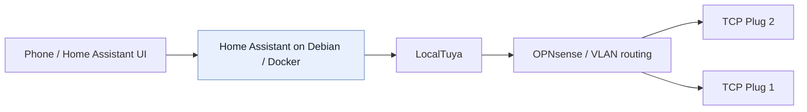

# Recovering local control of two TCP Smart Wi-Fi plugs

Two old Wi-Fi smart plugs. One goal: **control them from Home Assistant without resetting them or losing their existing setup.**

What seemed like a simple smart-home project turned into an investigation involving network traffic, an Android test emulator and Python. I eventually recovered the information needed for direct local control and confirmed that **both plugs worked in Home Assistant** while keeping their original TCP Smart app pairing.

**Result:** 2 out of 2 plugs working, confirmed 24 October 2026. Home Assistant could send commands directly across my local network; I have **not yet tested what happens if internet access is blocked completely**.

> This is a documented investigation of my own equipment, not a ready-made key-recovery guide. The four historical Python scripts are [sanitised archival copies](scripts/original-sanitised/) with private identifiers removed. The [separate example script](examples/local_switch_check.py) is reconstructed and read-only unless switching is explicitly requested.

## Where to start

- **[The investigation](docs/investigation.md):** what I tried, what failed, and what eventually worked.
- **[Home Assistant integration](docs/home-assistant.md):** how I added both plugs to my existing installation.
- **[Results and limitations](docs/validation.md):** what I verified and what still needs testing.
- **[Read-only DPS monitor](examples/monitor_dps.py):** safely observe device datapoints such as the countdown timer.
- **[Original sanitised scripts](scripts/original-sanitised/):** historical source files, not plug-and-play tools.
- **[Command history and evidence index](docs/cli-index.md):** recovered commands, reconstructed examples and source limitations.

## A few terms used below

- **Home Assistant (HA):** open-source software for controlling smart-home devices together.
- **LAN:** local area network — devices communicating within the home rather than sending every command through a manufacturer's cloud service.
- **VLAN:** a way to separate groups of devices on the same physical network; my IoT (smart-device) equipment has its own network.
- **ADB:** Android Debug Bridge, used to inspect and troubleshoot the test Android installation.
- **OEM app:** the manufacturer's original TCP Smart application.
- **DPS:** a Tuya device's numbered data point; **DPS 1** is the on/off switch state. A later test identified **DPS 2** as the countdown-to-toggle (seconds) on TCP Plug 2.
- **Local key:** a private per-device value needed to authenticate encrypted local commands.

## The problem

I had two older TCP Smart Wi-Fi plugs that still worked in their original Android app. I wanted them in my Home Assistant setup, controlled **directly on my LAN**, while retaining the existing pairing. A factory reset or moving them to another app would have been easier, but it would not have answered the technical question.

The first obstacle wasn't connectivity: both plugs were reachable locally. For encrypted on/off commands, however, each plug required its own 16-character local key, which the OEM app did not expose.

## Outcome at a glance

| Requirement | Verified result |
| --- | --- |
| Read relay states without changing the devices | Yes — TinyTuya protocol 3.1 reported DPS 1 on both plugs |
| Recover candidate local keys without re-pairing | Yes — using an inspectable emulator and targeted runtime diagnostics |
| Prove encrypted local on/off control | Yes — independently tested on both devices |
| Preserve original TCP Smart pairing | Yes |
| Show the original app reflecting an external relay change | Yes — observed for the TCP Plug 2 |
| Integrate with Home Assistant | Yes — both working as LocalTuya switch entities |
| Configure Tuya Cloud API credentials in Home Assistant | **Not required** |
| Prove operation with all internet/cloud access blocked | **Not yet tested** |
| Quantify response-time improvement | **Not yet measured** |

## Setup (sanitised)

- Two **TCP Smart** UK Wi-Fi plug models in the **TAFWISSINWUK** family, firmware compatible with **Tuya LAN protocol 3.1**.
- **OPNsense** routing between a trusted/home-lab VLAN and an isolated IoT VLAN; both plugs reachable over **TCP/6668**.
- **Lenovo Yoga / Debian 13** running **Home Assistant Container** under Docker Compose.
- Windows workstation for Android Studio, ADB, inspection tooling and the initial Python checks.
- Android Studio test emulator running the genuine OEM app, signed into the existing account; **the everyday handset was not rooted**.



The arrows show the *command path tested in Home Assistant*. The original OEM app remained paired separately; its cloud/LAN status-update mechanism wasn't conclusively traced.

## How I approached it

1. **Establish the basics.** Confirm model identifiers, network addresses, reachability and local protocol behaviour using packet captures, a TCP connection test and TinyTuya status requests.
2. **Separate read from write.** Protocol 3.1 returned the two plugs' relay status with an empty local key. That did **not** permit encrypted on/off control.
3. **Investigate the OEM Android app.** Used ADB to retrieve its installed APK components; confirmed Tuya/ThingClips SDK references to local-key handling. APK inspection alone did not reveal the account's individual device keys.
4. **Test, then discard unsuccessful approaches.** Investigated app storage and MMKV; tested **Frida** attachment in a rooted Android Studio emulator. Frida consistently terminated the app at attachment, before any instrumentation script ran. The cause was not established.
5. **Change method.** Used targeted, *read-only* inspection of the **running app's mapped memory inside the rooted emulator**. Searched around known device identifiers for device records, associated 16-character `localKey` candidates with the correct IDs by parsing their **same JSON object**, and saved the results privately. Mere string matches were never treated as proof.
6. **Validate against physical hardware.** A Python/TinyTuya check issued local commands to each plug and observed their response. On the TCP Plug 2, the script restored its original state and I saw it switch off and back on. The TCP Smart app also reflected the externally initiated state change.
7. **Integrate into Home Assistant.** Installed **LocalTuya** as a custom integration, skipped Tuya Cloud API account configuration, manually added each device using its own recovered key, selected **protocol 3.1**, and mapped **DPS 1** to a switch. Both plugs worked in HA; TCP Plug 2 was also tested from my phone.

Detailed notes: [Investigation and failed approaches](docs/investigation.md) · [Home Assistant configuration](docs/home-assistant.md) · [Evidence and remaining tests](docs/validation.md).

## Reconstructed local test example

[`examples/local_switch_check.py`](examples/local_switch_check.py) is a deliberately **safe-by-default** TinyTuya example inspired by the final verification stage. It reads the relay state by default and **does not switch anything** unless `--toggle` is explicitly supplied. When asked to toggle, it attempts to restore the original state even if the test fails.

```bash
python -m pip install -r requirements.txt
python examples/local_switch_check.py
# Explicitly opt in to a brief physical switch test:
python examples/local_switch_check.py --toggle
```

You'll be prompted for the device ID, LAN address and private key. The key is entered through a non-echoing prompt. **Use a safe test load:** a plug can interrupt mains power to connected equipment.

This sample deliberately avoids hard-coded real device IDs, addresses or keys. For the actual project, private key material was kept in a local Windows file; it was **not** committed to GitHub.

## Read-only datapoint monitor

The [sanitised countdown-observation monitor](examples/monitor_dps.py) is a separate, **read-only** TinyTuya example. It prompts for the device ID, LAN address, protocol version and local key (hidden input); no identifiers or keys are hard-coded or saved. It polls `status()` every ten seconds by default, printing datapoint values with local timestamps. It has no relay-toggle command.

```bash
python -m pip install -r requirements.txt
python examples/monitor_dps.py
# Optional: poll every five seconds
python examples/monitor_dps.py --interval 5
```

This published script is a **sanitised adaptation**, not the original private Windows monitor, which read its credentials from a local JSON file. The original was used in the [28 October countdown experiment](docs/validation.md#countdown-datapoint-experiment--28-october-2026). If another controller (such as Home Assistant LocalTuya) maintains a device connection, status polling may fail; investigate rather than assuming an incorrect key. Do not enter private keys in terminal transcripts or screenshots.


### Home Assistant countdown control (28 October 2026)

The LocalTuya Number entity for DPS 2 correctly displays a countdown on TCP Plug 2. A `number.set_value` request of 60 was accepted by Home Assistant but did not change the timer. The `localtuya.set_dp` action writing integer 60 to DPS 2 worked: the displayed value progressed 60 → 30 → 0 and the relay toggled automatically. The cause of the Number write failure is still unknown. A direct write of zero to cancel the timer and a convenient dashboard interface are proposed follow-ups, not completed work. Full observations: [validation notes](docs/validation.md#home-assistant-countdown-control--28-october-2026).

## What this demonstrates

- Breaking a problem into reachability, status, authentication, control and integration stages.
- Network diagnosis across VLANs, including TCP/6668 and source/destination reasoning.
- Android app analysis with ADB and an isolated emulator.
- Recording dead ends without inventing explanations for them.
- A testable recovery hypothesis: matching the right candidate value to the right device record.
- Validation at both software and physical layers.
- Handling recovered credentials responsibly and publishing only sanitised evidence.

## Limitations and follow-up

- **No deliberate cloud-blocking test yet.** The LocalTuya commands are sent directly over the LAN, but I have not yet measured behaviour after completely blocking these devices from the internet.
- **Latency is anecdotal.** Home Assistant subjectively seemed quicker than the original app, but I haven't captured controlled timings; nor did I independently confirm the original app's command path.
- **Protocol and firmware are device-dependent.** Identical branding does not guarantee other revisions work the same way. Different devices also have different keys.
- **Countdown datapoint tested 28 October 2026.** On TCP Plug 2, DPS 2 reports the OEM countdown-to-toggle in seconds, with 30-second reported steps; a one-minute timer ended with an automatic DPS 1 toggle and DPS 2 resetting to zero. Weekly schedule storage and cloud-offline operation remain untested. See [timestamped evidence](docs/validation.md#countdown-datapoint-experiment--28-october-2026).

The countdown investigation also showed that disabling the device in Home Assistant did not release the TinyTuya connection, while temporarily stopping the HA container allowed read-only polling. This is evidence of a local-controller connection conflict, not a proven protocol limitation. HA restoration after testing was advised but has not yet been independently confirmed.

## Tools and references

- [TinyTuya](https://github.com/jasonacox/tinytuya) — direct LAN status/control for Tuya-compatible devices.
- [LocalTuya](https://github.com/rospogrigio/localtuya) — Home Assistant local integration, optional Tuya cloud account.
- Android Studio emulator, ADB, Frida (unsuccessful attachment), Wireshark/packet capture, Python, Docker, Home Assistant, OPNsense.

## Security and publishing

See [Security and redaction checklist](docs/security.md). Do **not** upload real keys, cloud credentials, APKs, proprietary app data, RAM dumps, screenshots showing a `local key` field, personal network details, or device identifiers. Only investigate devices/accounts you own or are authorised to test.

For the source-code provenance, see [Source provenance and limitations](docs/source-provenance.md).\n\n**Project record:** initial investigation 20–21 October 2026; Home Assistant integration verified 24 October 2026.

## Recovered original command material (October 2026)

- [Recovered safe CLI excerpts](docs/recovered-cli-safe-excerpts.md): commands copied from the 224-position conversation archive, with private identifiers redacted. These are individual historical snippets, **not** a runnable installation script.
- [Original Home Assistant Compose service](config/homeassistant/compose.example.yml): deployment YAML retrieved from the conversation.
- [Source provenance and publication limitations](docs/source-provenance.md): what was recovered, what remains private, and a known mismatch in the original LAN-switch script.
- [CLI investigation journal](docs/cli-command-journal.md): explanatory documentation including **illustrative** commands; this is distinct from the historical excerpt collection.

**Original Python sources:** Four sanitised original scripts are published in [scripts/original-sanitised](scripts/original-sanitised/). They contain placeholders and are historical artefacts, not ready-to-run tools. The original LAN-switch script's device-label mismatch has been normalised to TCP Plug 1 (the target defined by its device constants). It remains archival and untested after sanitisation.

The 37 public historical code/output blocks are in [recovered safe CLI excerpts](docs/recovered-cli-safe-excerpts.md); [the remaining 27 blocks have been reviewed individually](docs/excluded-blocks-review.md) and retained in the private archive. Accounting covers all 64 without publishing sensitive emulator diagnostics or trivial outputs.
